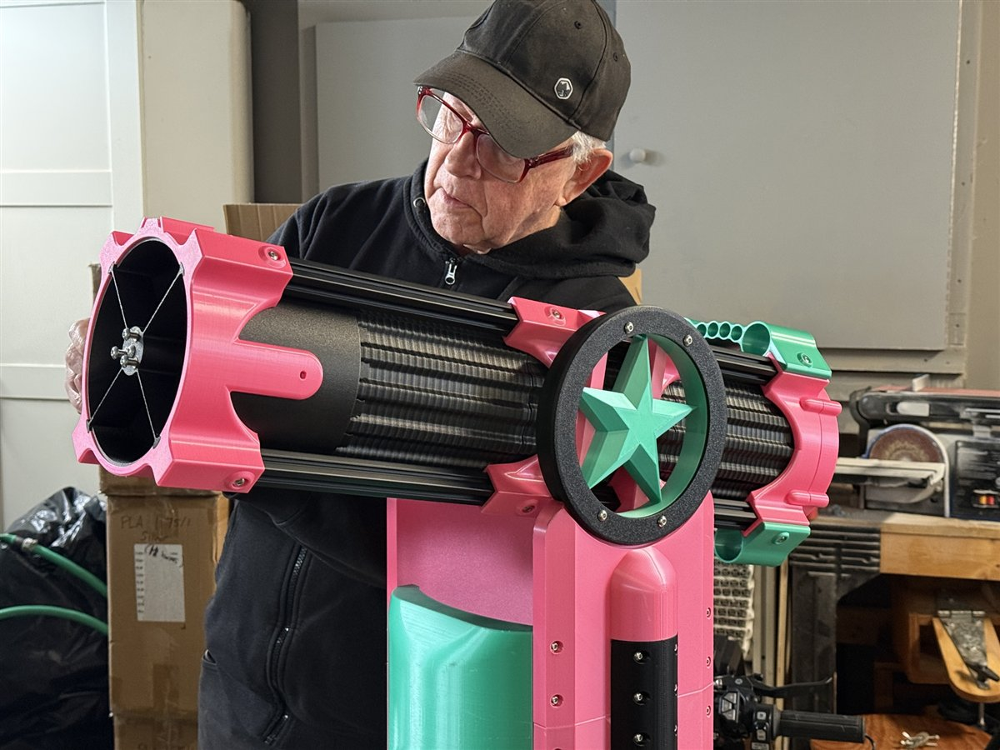
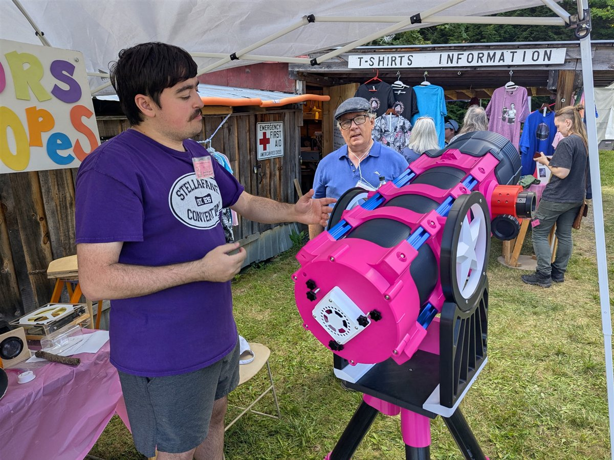
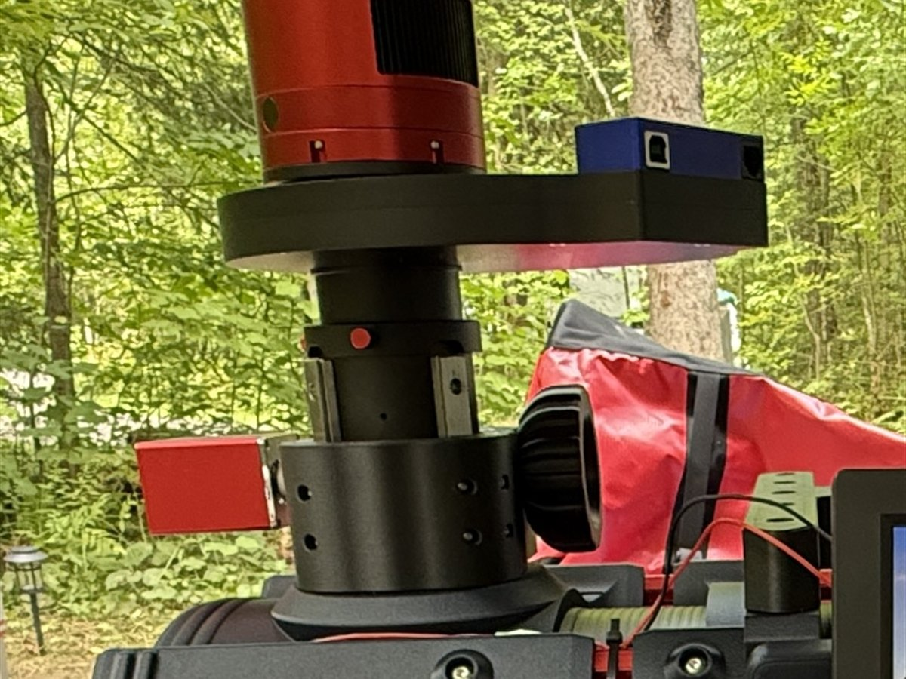
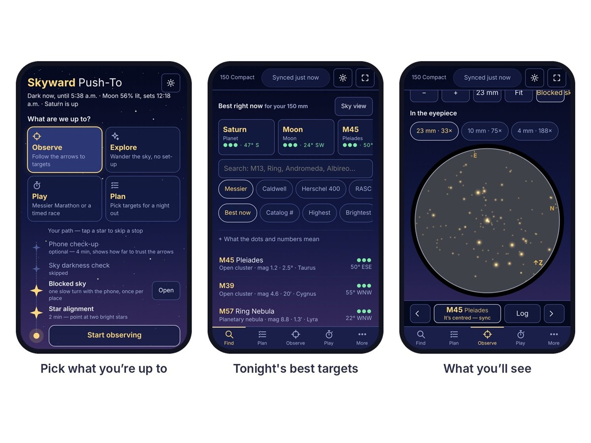

  <picture>
    <source media="(prefers-color-scheme: dark)" srcset="images/wordmark-light-text.png">
    
  </picture>

  <strong>Open source telescopes you can 3D print and build yourself.</strong> 
  From Guelph, Ontario.

  <a href="https://www.tentelescopes.com">Website</a> ·
  <a href="https://www.youtube.com/@TenTelescopes">YouTube</a> ·
  <a href="https://discord.gg/kwv2z3wfGd">Discord</a> ·
  <a href="https://www.instagram.com/tentelescopes">Instagram</a> ·
  <a href="https://tundra3d.ca/?utm_source=github&utm_medium=referral&utm_campaign=profile">Kits</a>

---

Ten Telescopes started when I designed and built a telescope for my niece. It worked so well that I decided to make a library of ten of the same scopes to loan out. People loved them, so I released the designs as open source, and it just got completely out of control from there. Now there are free designs anyone can print, a lending library in Guelph, and thirty Skyward 200s built for the Young Galileos program.

## Projects

<table>
  <tr>
    <td width="50%" valign="top">
      
      <h3><a href="https://github.com/TenTelescopes/Skyward150">Skyward 150</a></h3>
      Our first Skyward. A 150 mm f/5 Newtonian on a tripod, good for the Moon, planets, star clusters and Messier objects. Printed parts need no supports.
    </td>
    <td width="50%" valign="top">
      
      <h3><a href="https://github.com/TenTelescopes/Skyward200">Skyward 200</a></h3>
      The big brother. A 200 mm f/4 Newtonian in two versions: visual on a Dobsonian rocker box and tripod, or the Skyward 200 Astrograph for astrophotography.
    </td>
  </tr>
  <tr>
    <td width="50%" valign="top">
      
      <h3><a href="https://github.com/TenTelescopes/Ten-Telescopes-2-Inch-Focuser">2 Inch Focuser</a></h3>
      A heavy duty 3D printed Crayford focuser with a 9:1 fine focus, ready for an electronic auto focuser.
    </td>
    <td width="50%" valign="top">
      
      <h3><a href="https://github.com/TenTelescopes/skyward-pushto">Skyward Push-To</a></h3>
      A phone app that rides on a Skyward and tells you which way to push to find your target. Runs offline on the phone.  
      <a href="https://tentelescopes.github.io/skyward-pushto/">Try it on a phone</a> · <a href="https://www.tentelescopes.com/post/testers-wanted-the-skyward-push-to-app">Testers wanted</a>
    </td>
  </tr>
</table>

## Get involved

- **Build one.** Each design has free STL files and build videos.
- **Ask questions and share your build** on [Discord](https://discord.gg/kwv2z3wfGd).
- **Rather not source the parts?** Optics and hardware kits are at [tundra3d.ca](https://tundra3d.ca/?utm_source=github&utm_medium=referral&utm_campaign=profile).

All designs are licensed [CC BY-NC 4.0](https://creativecommons.org/licenses/by-nc/4.0/). For commercial inquiries: admin@tentelescopes.com
